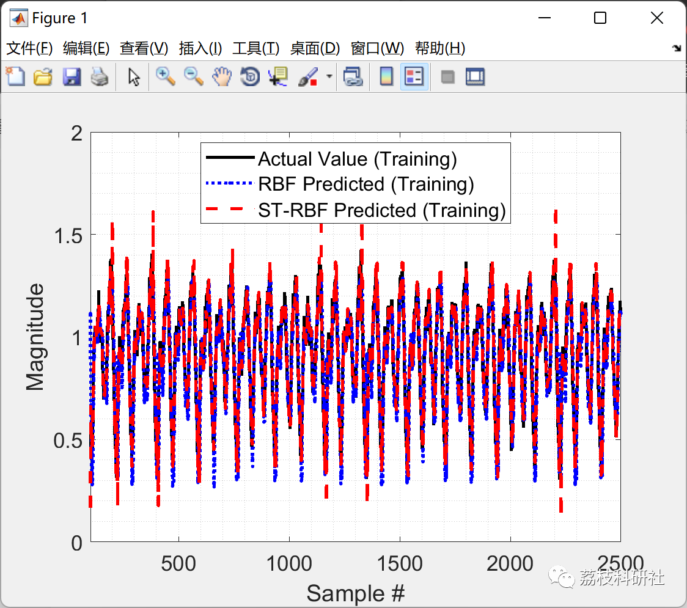
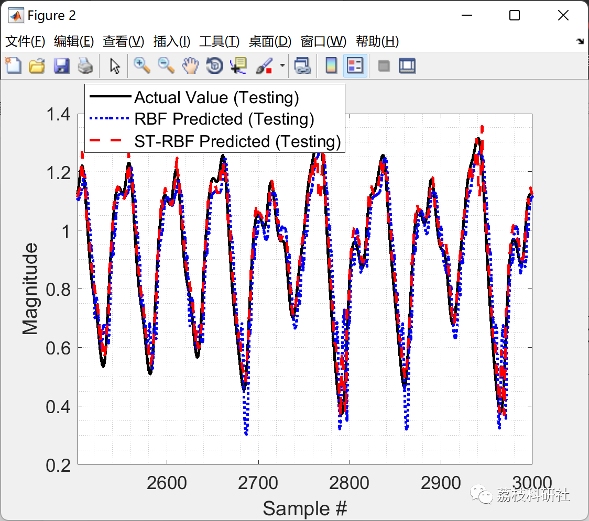
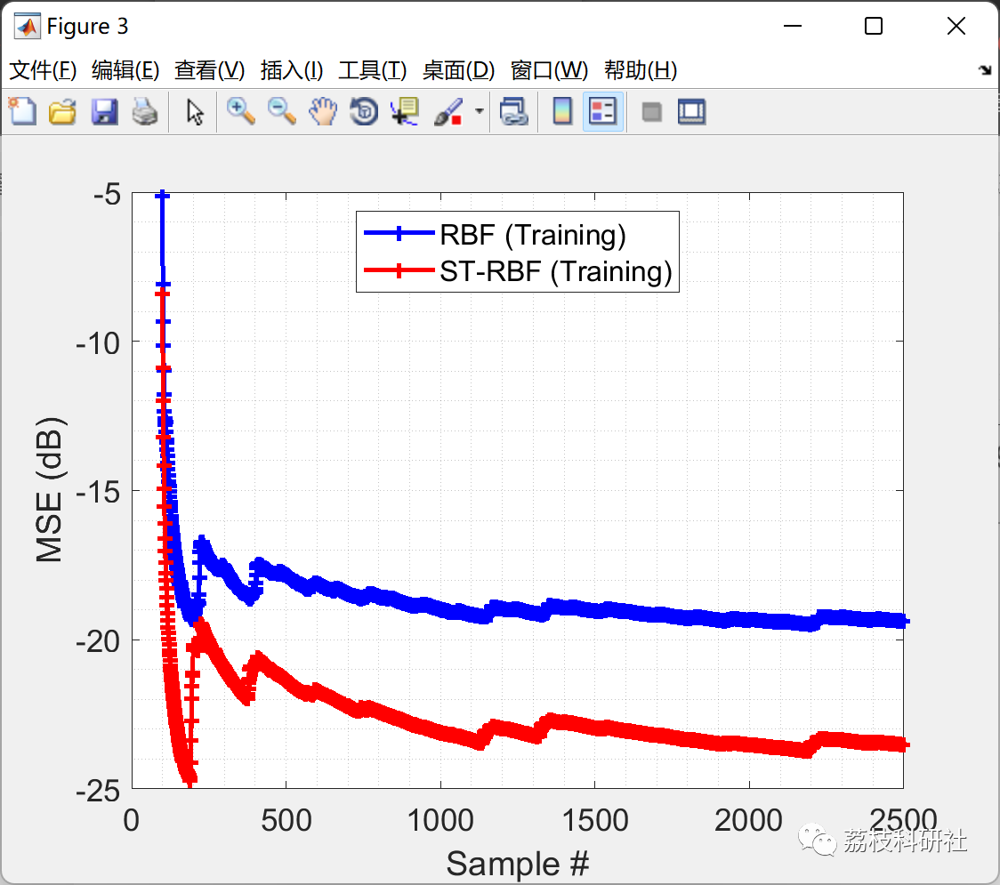
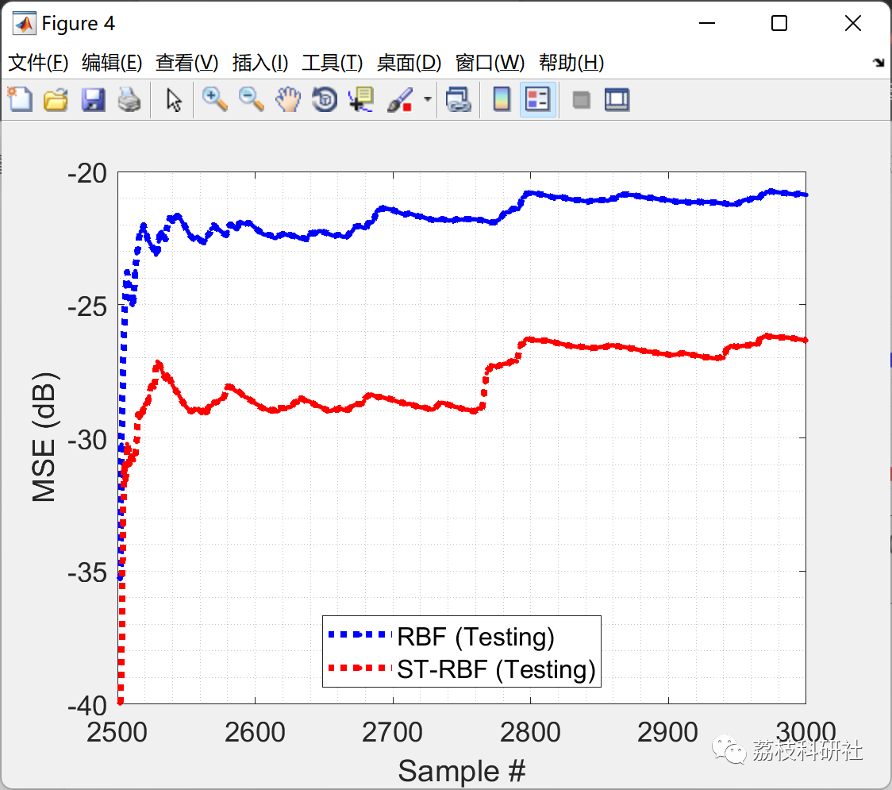

# Chaotic Time Series Prediction Based on Spatio-Temporal RBF-NN (Matlab Code Implementation)

💥1 Overview
This article presents two variants of the Radial Basis Function Neural Network (RBF-NN) used for chaotic time series prediction tasks. Specifically, it compares the traditional implementation of RBF with a spatial-temporal RBF-NN and Mackey-Glass time series prediction.
📚2 Running Results
🎉3 References
[1] Sadiq, Alishba, et al. "Chaotic Time Series Prediction using Spatio-Temporal RBF Neural Networks." 2018 3rd {IEEE} International Conference on Emerging Trends in Engineering, Sciences and Technology ({ICEEST}), {IEEE}, 2018
🌈4 Matlab Code Implementation
Click the bottom left corner of this article to read.

## Images

<!-- PAYMENT_BLOCK -->

## Get this dataset

- Payment link (Stripe): [Buy now](https://buy.stripe.com/3cs8yP7sY87d0vu9AB)
- Payment QR code: 

<!-- /PAYMENT_BLOCK -->
